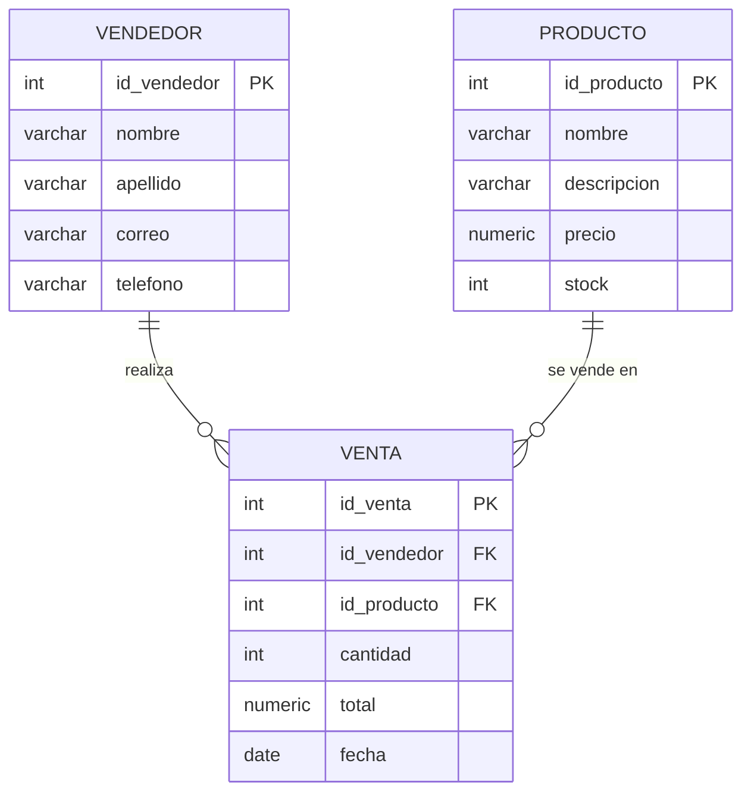

# Diagrama de la base de datos

Las imagenes estan en esta misma carpeta:

- `diagrama_tablas.png` / `.svg`: tablas con sus llaves primarias (PK) y foraneas (FK)
- `diagrama_flujo.png` / `.svg`: como viaja la informacion entre el front, el back y la base de datos

Si lo abres en GitHub o en VS Code con la extension de Mermaid tambien se ve este:

## Relaciones

| Tabla venta | Referencia a | Tipo |
|---|---|---|
| id_vendedor (FK) | vendedor.id_vendedor (PK) | un vendedor puede tener muchas ventas (1 a N) |
| id_producto (FK) | producto.id_producto (PK) | un producto puede estar en muchas ventas (1 a N) |
